# AI SDLC — Notas manuscritas

## 1. AI SDLC: introducción y alcance

Primero, vamos a plantear una serie de definiciones, una introducción, el objetivo y el alcance.

SDLC será el ciclo completo de desarrollo de software, desde la idea o propuesta inicial hasta tener la feature en producción. Este ciclo estará compuesto por un conjunto de:

- Fases o etapas.
- Artefactos.
- Tecnología.
- Estados.
- Transiciones.
- Interacciones (feedback loops).

### Análisis

La idea o propuesta se escribe como una spec, requerimiento, use case o user story. Se evalúa y se prioriza.

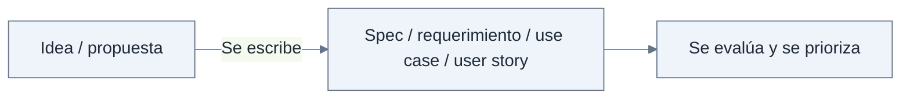

### Diseño e implementación

Se diseña y se generan los artefactos:

| Área | Artefactos |
|---|---|
| Dev | SAD, ADR, spec → ref. [abreviatura poco clara], otros. |
| QA | Test spec y acceptance criteria. |

La implementación tiene un ciclo entre Dev y QA.

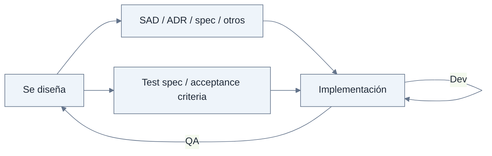

### Validación y entrega

Se valida mediante test, E2E, Ops y Sec. Luego: PR, revisión, feedback y aprobación.

Ops + Sec acompañan la secuencia de entornos Dev → UAT → Prod.

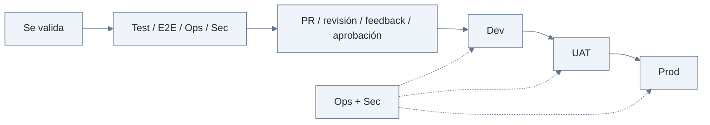

## 2. Roles y disciplinas


En el ciclo de desarrollo se involucran diferentes roles del equipo para analizar diferentes aspectos del SDLC. Aún no hemos introducido la IA.

- Analistas funcionales o Product Owner.
- Equipo de desarrollo:
  - Backend.
  - Frontend.
  - Architecture.
  - Infra (Ops).

Cada persona, en su rol, vela por su disciplina para asegurar que todos los proyectos y cada proyecto en sí mismo mantengan una coherencia general. Pero a veces es difícil entender y aplicar estas normas en todos los proyectos, en cada proyecto individual e incluso en el mismo proyecto cuando el equipo de desarrollo cambia (rotación del personal).

Luego tenemos las grandes disciplinas:

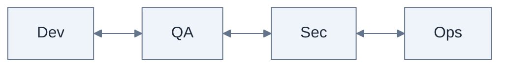

## 3. Dev y QA: pruebas y gestión de incidencias


[Continuación de la página anterior.] Separé Dev y QA porque, en muchos casos, solo se entiende QA como tests unitarios y algún test de integración, cuando en realidad hay mucho más ahí dentro:

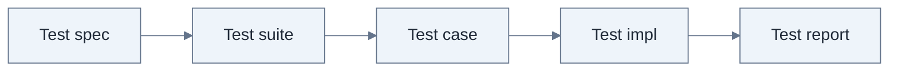

El esquema continúa con issue spec, issue management y el ciclo de vida de la incidencia, compartido por Dev + QA.

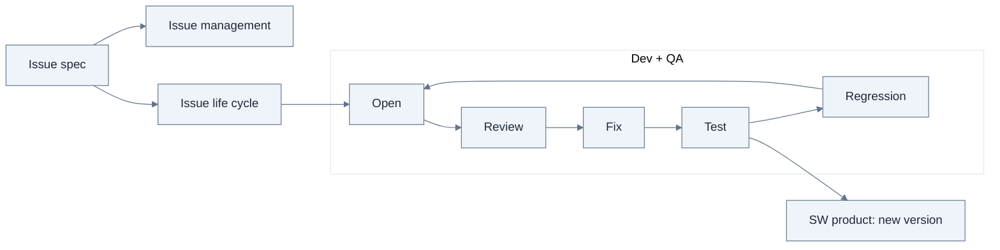

Otro aspecto clave del SDLC son las reglas y estándares generales —digamos, de la industria— y luego los específicos de la empresa o equipo. Por ejemplo:

- Codificación: tiene alguna dependencia con la tecnología utilizada.
- Documentación: README, changelog, docs.
- Change management: versioning y dependencias.
- SAD + ADR.
- Seguridad y despliegue. [Línea parcialmente cortada.]

## 4. Template, estándares y ecosistema del proyecto


Una buena práctica, por lo general, es definir para un proyecto dado un template de la estructura —esqueleto— y agregar o definir los estándares y reglas para que cualquier desarrollo, mejora o cualquier otro aspecto que modifique el proyecto siga los lineamientos y mantenga una coherencia general.

Ahora vamos a introducir las tecnologías y sistemas/herramientas externas que normalmente hacen al ecosistema donde existen o viven los proyectos dentro de cualquier empresa:

| Aspecto | Sistemas, herramientas o elementos |
|---|---|
| Tareas | Jira / GitHub Issues / Trello. |
| Código | Repositorio Git o similar que provea control de cambios. |
| Documentación | Confluence / discos de docs. |
| Diagramas | Freeform / UML → Mural / PlantUML. |
| Toolchain | Compiladores, test framework, IDE. |
| Infra | Ambientes: Kubernetes, deploy, pod. |
| CI/CD | GitHub Actions / workflows. |
| Análisis de código | SonarQube → [continuación]. |

## 5. Capas de elementos del SDLC


- Análisis de seguridad → Snyk.
- Observabilidad → logs, Datadog, etc.

Entonces, en el SDLC tenemos varias capas de elementos que lo componen:

| Nº | Capa | Elementos |
|---|---|---|
| 1 | Proceso | Idea → producción: análisis, diseño, implementación, pruebas, seguridad. |
| 2 | Personas y roles | Responsabilidades, disciplinas, tareas. |
| 3 | Disciplinas | Dev, QA, Sec, Ops, negocio. |
| 4 | Reglas y estándares | Codificación, documentación, arquitectura, seguridad, integración, dependencias. |
| 5 | Tecnologías y herramientas | GitHub, Sonar, Snyk, Jira, Confluence, toolchain, IDE, Datadog, AWS / Azure. |
| 6 | Gestión de proyecto | Horas, avance, recursos, roadmap, sprints, planning, retro. |

## 6. Definir el SDLC antes de integrar IA

Todo lo anterior —la definición de lo que es SDLC— es esencial. Es clave que esté definido explícitamente, escrito y claramente bien organizado para que, al momento de querer integrar la IA dentro, o mejor dicho junto a cada pieza del rompecabezas anterior, el resultado final sea un framework de AI SDLC completo, coherente, útil y realista, tomando en cuenta el grado de madurez actual de la IA.

Para poder crear un AI SDLC, se haría el mismo ejercicio que con el SDLC tradicional: primero, definir conceptos básicos, procesos, reglas, estándares, herramientas, tecnologías, roles y cómo se efectúa la gestión de proyectos usando IA.

Luego de definir todos estos aspectos, se procederá a integrarlos en el SDLC.

## 7. Principales definiciones en el mundo de la IA


| Nº | Concepto | Nota |
|---|---|---|
| 1 | Modelos | LLM: Large Language Models. |
| 2 | AI Provider | Anthropic, OpenAI, Google. Modelos: Sonnet, GPT, Gemini; agrupados como foundation model en el esquema. |
| 3 | Multimodal | Texto, imágenes, audios, vídeos. |
| 4 | Tokenización | Proceso de traducir texto en números, luego asignar un índice y convertir el input en embeddings. |
| 5 | Inferencia | Proceso de generar contenido con lo aprendido. |
| 6 | Prompt | Instrucción. |
| 7 | Prompt engineering | Diseñar, ajustar y optimizar prompts. |

> Nota de transcripción: se conserva la formulación original sobre tokenización y embeddings, sin corrección conceptual.

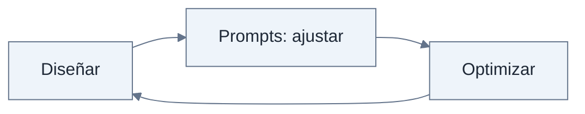

## 8. Contexto, memoria y razonamiento


### 8. Context

Toda la información disponible para un modelo en una acción.

### 9. Context engineering

Diseñar y gestionar el contexto:

- Prompt.
- Historial.
- Sesiones.
- Skills.
- Tools.

### 10. Memory

- Agent memory.
- Project assets.
- Company docs.
- Other assets.

Estos elementos se agrupan como knowledge base.

### 11. Semantic Search

[El original solo contiene el título y una relación gráfica con la knowledge base.]

### 12. LLM: razonamiento

- Temperatura del modelo.
- Chain of thoughts.
- Tools use:
  - Filesystem.
  - Others.
- Planning.
- Self-consistency / reflection.

MoE → router de tareas interno para seleccionar submodelos especializados para cada input.

### 13. Sobre los agentes

- Skills → capacidades.
- Subagentes → agentes especializados, con contexto propio.
- Copilot → HIL (Human in the Loop).
- Agent orchestration:
  - Plan.
  - Implement.
  - Validate.
  - Feedback.
- Memory:
  - Memory unit.
  - Context engineering.
  - Memory engineering.
  - Vector database.
  - Embeddings.
  - Tools + MCP.
- Observabilidad.

### 14. Seguridad y ética

- Jailbreak.
- Prompt injection.
- Bias, alignment, AI safety.
- Governance.
- Guardrails.

### 15. Tendencias

- Agent economy.
- Local AI.
- AI native.

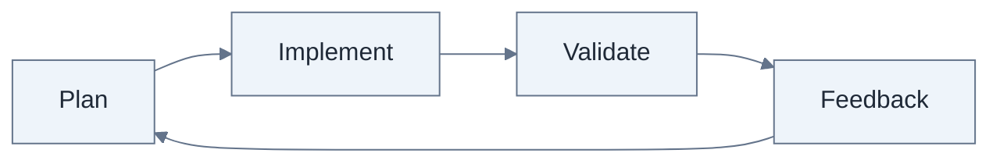

## 10. SDD — Spec-Driven Development


### 16. SDD

Se basa en el concepto de crear artefactos —siempre en Markdown— que definen las specs, es decir, las especificaciones de lo que se quiere construir.

Los frameworks que usan estas metodologías son:

- OpenSpec.
- Spec Kit.
- AWS AI DLC, etc.

Estos frameworks funcionan acoplándose a un folder de trabajo —repositorio— y agregando hooks internos al harness del modelo que se está usando.

Estos hooks internos son, por ejemplo, para Claude, Codex u OpenCode:

```text
/agents
/commands
/rules
/skills
```

## 11. Definición importante: agente


Agente = LLM + Harness.

LLM → modelo fundacional.

| Parte | Elementos del esquema |
|---|---|
| LLM | AI model, reasoning effort, context, etc. |
| Harness | Context, tools, memory, loop. |

Volviendo a SDD: además de los hooks que se agregan, los frameworks de SDD añaden sus propios artefactos al folder de trabajo.

```text
/openspec
├── changes
├── schemas
└── specs
```

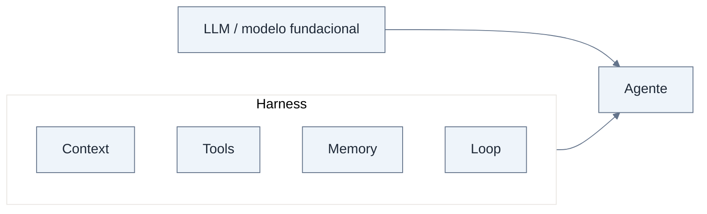

## 12. Ejecución de los frameworks SDD y control humano


Ahora bien, todos estos frameworks se basan en ser usados por agentes de IA. Para esto, cada framework tiene su propia forma de funcionar o ejecutarse:

| Framework | Forma de ejecución anotada |
|---|---|
| AWS AI DLC | Engine + driver → YAML; alto grado de autonomía. |
| OpenSpec | Spec + rules que un agente sigue. |
| Spec Kit | Workflow engine en YAML. |

Entonces, los frameworks de SDD definen los workflows de trabajo indicando fases o etapas y generando artefactos intermedios que permiten definir puntos de control, o Human in the Loop, para que los humanos validen, actualicen o indiquen cómo debe continuar el framework.

## 13. Memoria e integraciones empresariales

Los frameworks SDD permiten la generación de soluciones basadas en IA bajo un determinado marco de trabajo y workflows controlados.

### Memoria

Otro aspecto crítico de estos frameworks y de la IA es la memoria —o knowledge— donde, si se trabaja en un mismo proyecto y folder o carpeta de trabajo, las sesiones, prompts, assets y demás artefactos viven y evolucionan desde esa misma estación de trabajo.

Pero, si hablamos de integraciones empresariales, hablamos de:

- Confluence, Jira, Notion, Figma.
- Repositorios varios y muchas personas.
- Chats, Slack, correos y otros documentos.

## 14. Skills

Las herramientas de IA —LLM + harness— hacen uso de skills para definir capacidades muy concretas o especializaciones para ejecutar determinadas tareas y para instanciar subagentes especializados con skills.

### Integraciones

Las integraciones se refieren a integrar agentes de IA con sistemas y herramientas externas a su propio harness.

Algunas integraciones se pueden hacer mediante:

- MCP.
- Tools → llamadas a CLI, CMD.

## 15. Modularidad e intercambiabilidad


De todas las partes, hay algunos aspectos que vale la pena mencionar.

### 1. Modularidad

Para que el sistema funcione correctamente, se debe crear cada parte de forma modular y genérica, debido a que la IA avanza tan rápido que cualquier parte del sistema puede ser intercambiable: LEGO system.

[El dibujo muestra una red de módulos conectados, uno tachado y un camino alternativo. Los módulos no tienen nombres.]

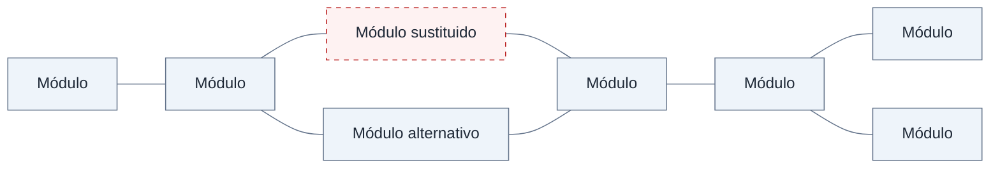

### 2. Entornos que permiten integrar y usar los LLM

- Codex.
- Pi.
- OpenCode.

Son parte del harness o una implementación concreta para aplicarlo. Los harness deben ser capaces de evolucionar, mejorar y cambiar.

## 16. Base de datos de skills

### 3. Base de datos de skills

La base de datos de skills es una forma de compartir conocimiento, técnicas y buenas prácticas.

Se deben mantener centralizadas; deben poder cambiar y evolucionar.

Markdown + Git.

- Lenguaje de IA.
- Evolución y distribución.

Pero las skills también deben evolucionar y mejorar. No solo es útil tenerlas centralizadas en Git y en Markdown: tiene que existir un mecanismo para actualizar y mejorar las skills.

Skill induction process.

## 17. MCP: contexto con el mundo exterior


### 4. MCP

MCP → contexto con el mundo exterior.

El protocolo funciona con una arquitectura cliente-servidor.

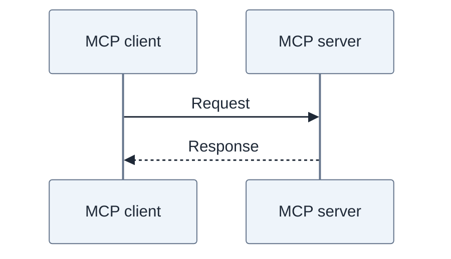

El host es una aplicación de IA:

- Claude Code.
- Codex.
- OpenCode.

Internamente usa dos layers:

- Data layer, basada en JSON-RPC 2.0.
- Transport layer: stdio —misma PC— y stream HTTP.

## 18. Juntando las partes
∫

El esquema reúne:

| Nº | Elemento |
|---|---|
| 1 | AI Provider: Anthropic, xAI, OpenAI. |
| 2 | AI Harness: Codex / OpenCode. |
| 3 | Skills. |
| 4 | MCP. |
| 5 | Org rules. |
| 6 | Team rules. |
| 7 | Knowledge: organización, mediante MCP. |
| 8 | Memory database, mediante MCP. |
| 9 | Cost optimization / orchestrator. |

El proyecto se trabaja desde la PC del desarrollador. Se relaciona con el trabajo —Work— y con knowledge y memory mediante MCP.

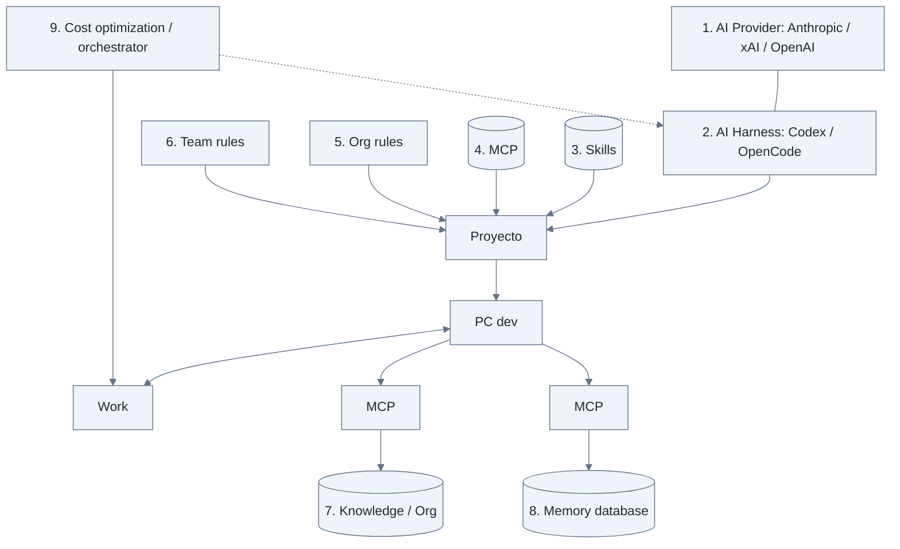

## 19. Host con múltiples clientes MCP

Fuente: `20261101_110956.jpg`.

Host #1: Claude Code.

| Cliente | Transporte | Servidor | Función | Tools anotadas |
|---|---|---|---|---:|
| MCP client 1 | stdio | MCP server 1 | Filesystem | 10 |
| MCP client 2 | stdio | MCP server 2 | Database | 15 |
| MCP client 3 | stream HTTP | MCP server 3, remoto | Atlassian | 72 |
| MCP client 4 | stream HTTP | MCP server 3, remoto | Atlassian | 72, compartidas en el mismo servidor del esquema |

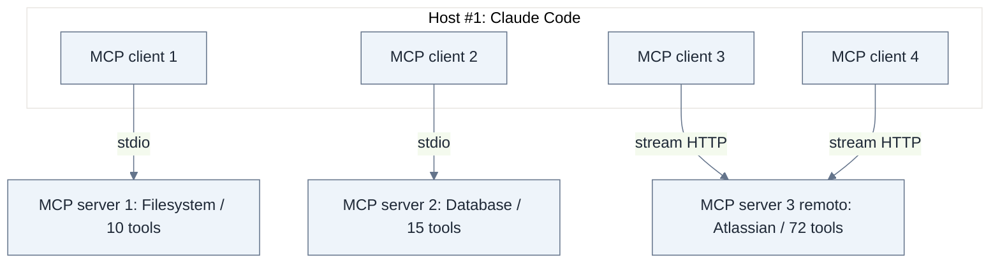

Ahora bien, desde el punto de vista de los MCP, su arquitectura, distribución, seguridad y capacidad de obtener contexto a través del uso de las tools, se deben definir a nivel empresarial varios aspectos:

- ¿Qué MCP se necesitan?

## Límites del material transcrito

Se han conservado los fragmentos visibles que terminan cortados, sin completarlos por inferencia. Las fotografías `20261101_111006.jpg` y `20261101_111009.jpg` constan entre los adjuntos, pero su contenido no se ha transcrito en esta versión. Por tanto, esta entrega no debe considerarse una transcripción íntegra de las 21 fotografías.
